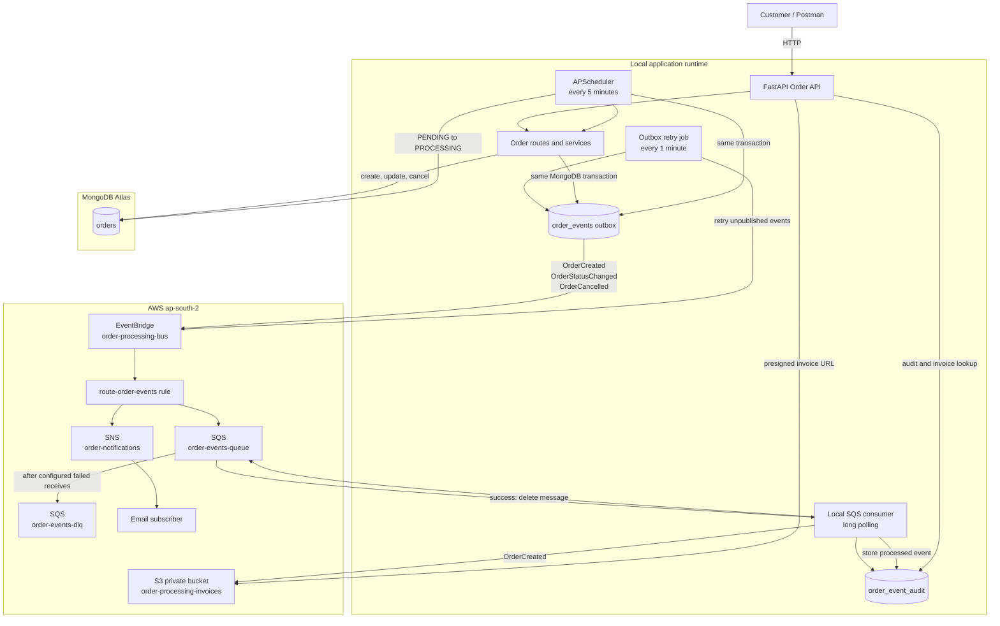
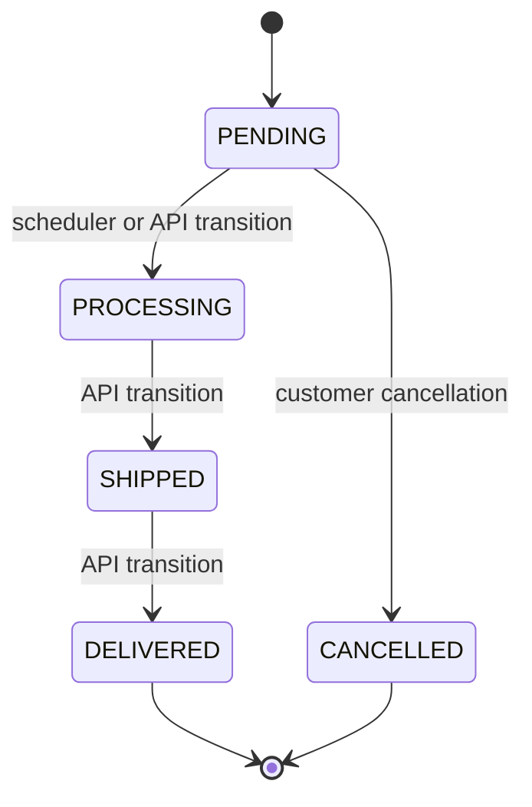

# Order Processing System

A production-oriented e-commerce order service built with **FastAPI**, **MongoDB Atlas**, **Amazon EventBridge**, **Amazon SQS**, **Amazon SNS**, and **Amazon S3**.

The application runs locally without Docker. It uses real MongoDB Atlas and AWS resources; no business data is seeded or mocked.

## Features

- Create an order containing multiple items.
- Retrieve an order by ID.
- List orders with status filtering and cursor pagination.
- Progress order status through `PENDING → PROCESSING → SHIPPED → DELIVERED`.
- Cancel only `PENDING` orders.
- Automatically move `PENDING` orders to `PROCESSING` every five minutes in local mode.
- Prevent duplicate order creation with an `Idempotency-Key` header.
- Publish immutable order lifecycle events to EventBridge through a transactional MongoDB outbox.
- Route events to SQS for reliable background processing and SNS for notifications.
- Process SQS messages idempotently and retain a MongoDB audit trail.
- Generate invoice PDFs and upload them to a private S3 bucket.
- Return short-lived presigned URLs for invoice downloads.
- Expose correlation IDs, health checks, readiness checks, consistent errors, retries, and a dead-letter queue workflow.

## Architecture



### Order event flow

```text
POST /orders
  → order and outbox event saved transactionally in MongoDB Atlas
  → EventBridge receives OrderCreated
  → EventBridge routes to SQS and SNS
  → SNS sends notification email
  → SQS consumer generates an S3 invoice PDF
  → SQS consumer stores the processed event in MongoDB audit history
```

## Project structure

```text
app/
├── api/
│   └── orders.py          # HTTP routes
├── services/
│   ├── consumer.py        # SQS worker and Lambda batch logic
│   ├── events.py          # Transactional outbox and EventBridge publishing
│   ├── invoices.py        # PDF invoice generation and S3 upload
│   └── scheduler.py       # Scheduled PENDING → PROCESSING workflow
├── config.py              # Environment-driven settings
├── constants.py           # MongoDB collection names
├── dependencies.py        # Shared FastAPI helpers
├── main.py                # App lifecycle and Lambda handlers
└── models.py              # Pydantic API contracts

main.py                    # Uvicorn and Lambda compatibility entry point
Order-Processing-System.postman_collection.json
README.md
```

## Prerequisites

- Python 3.13 or later
- MongoDB Atlas cluster and connection string
- AWS CLI configured with an AWS account in `ap-south-2`
- AWS resources listed in [AWS resources](#aws-resources)

## Local setup

### 1. Create and activate a virtual environment

```powershell
py -m venv .venv
.\.venv\Scripts\Activate.ps1
```

### 2. Install dependencies

```powershell
pip install fastapi "uvicorn[standard]" motor pymongo apscheduler boto3 mangum reportlab
```

### 3. Configure environment variables

PowerShell example:

```powershell
$env:MONGODB_URI = "mongodb+srv://<username>:<password>@<cluster>/<database>?retryWrites=true&w=majority"
$env:MONGODB_DATABASE = "order_processing"
$env:AWS_REGION = "ap-south-2"
$env:EVENTBRIDGE_EVENT_BUS_NAME = "order-processing-bus"
$env:SQS_QUEUE_NAME = "order-events-queue"
$env:S3_INVOICE_BUCKET = "order-processing-invoices"
```

Never commit credentials or the MongoDB connection string.

### 4. Start the API

```powershell
.\.venv\Scripts\uvicorn.exe main:app --reload
```

Open Swagger UI at <http://127.0.0.1:8000/docs>.

## API reference

| Method | Endpoint | Description |
|---|---|---|
| `GET` | `/health` | MongoDB liveness check |
| `GET` | `/health/ready` | MongoDB, EventBridge, SQS, and S3 readiness check |
| `POST` | `/orders` | Create an order |
| `GET` | `/orders?status=PENDING&limit=20` | List/filter orders with cursor pagination |
| `GET` | `/orders/{orderId}` | Retrieve an order |
| `PATCH` | `/orders/{orderId}/status` | Advance an order status |
| `POST` | `/orders/{orderId}/cancel` | Cancel a pending order |
| `GET` | `/orders/{orderId}/events` | Retrieve processed order event history |
| `GET` | `/orders/{orderId}/invoice` | Generate a five-minute presigned invoice URL |

### Create order

```http
POST /orders
Content-Type: application/json
Idempotency-Key: 8d0c1eb0-6de5-4d7b-a13d-7c3ae4c9e1b1
X-Request-ID: checkout-001
```

```json
{
  "customer_id": "customer-123",
  "items": [
    {
      "product_id": "SKU-HEADPHONES-001",
      "name": "Wireless Headphones",
      "quantity": 1,
      "unit_price": 99.99
    }
  ]
}
```

### Pagination

```http
GET /orders?limit=20&cursor=<next_cursor>
```

```json
{
  "items": [],
  "next_cursor": "<mongo-object-id-or-null>"
}
```

### Standard error response

```json
{
  "error": {
    "code": "HTTP_409",
    "message": "Only PENDING orders can be cancelled",
    "request_id": "checkout-001"
  }
}
```

## Order lifecycle



## AWS resources

Create these resources in the same region, `ap-south-2`.

| Service | Resource | Purpose |
|---|---|---|
| EventBridge | `order-processing-bus` | Custom order-event bus |
| EventBridge | `route-order-events` | Routes matching order events |
| SQS | `order-events-queue` | Durable asynchronous order-event queue |
| SQS | `order-events-dlq` | Failed-message investigation queue |
| SNS | `order-notifications` | Email notification fan-out |
| S3 | `order-processing-invoices` | Private invoice PDF storage |

### EventBridge rule pattern

```json
{
  "source": ["order.processing"],
  "detail-type": [
    "OrderCreated",
    "OrderStatusChanged",
    "OrderCancelled"
  ]
}
```

Configure two rule targets:

1. `order-events-queue` (SQS)
2. `order-notifications` (SNS)

Confirm the SNS email subscription before testing.

### S3 security settings

- Keep **Block Public Access** enabled.
- Keep ACLs disabled with **Bucket owner enforced**.
- Enable versioning.
- Use server-side encryption with S3-managed keys (SSE-S3).
- Do not store permanent public invoice URLs.

## Reliability and operational behavior

### Transactional outbox

Order updates and their outbound events are stored together in MongoDB transactions. The event is published only after the transaction commits. If EventBridge is unavailable, the event remains in `order_events` and the retry job tries again every minute.

### Idempotency

`Idempotency-Key` is optional for backward compatibility but strongly recommended for every `POST /orders` request.

- Same key + identical payload: returns the existing order with `200 OK`.
- Same key + different payload: returns `409 Conflict`.

### SQS processing and DLQ

SQS delivery is at-least-once. The consumer uses `event_id` as a unique key in `order_event_audit`, so duplicate deliveries are ignored safely. A failed message is not deleted; SQS retries it and moves it to `order-events-dlq` after the configured receive limit.

### Invoice storage

The order record stores metadata, not a permanent S3 URL:

```json
{
  "invoice": {
    "s3_bucket": "order-processing-invoices",
    "s3_key": "invoices/<order-id>/invoice.pdf",
    "content_type": "application/pdf",
    "generated_at": "<UTC timestamp>"
  }
}
```

`GET /orders/{orderId}/invoice` creates a fresh presigned URL that expires in 300 seconds.

## Postman validation

Import [Order-Processing-System.postman_collection.json](./Order-Processing-System.postman_collection.json) into Postman.

Recommended validation sequence:

1. Run `Health Check`.
2. Create an order with an `Idempotency-Key` header.
3. Retrieve the order and confirm `PENDING`.
4. Confirm `OrderCreated` in `/orders/{orderId}/events`.
5. Verify the SNS email and SQS processing logs.
6. Retrieve `/orders/{orderId}/invoice` and open the presigned PDF URL.
7. Wait for the scheduler and confirm `PROCESSING` plus a second audit event.
8. Create another pending order and cancel it.

## Lambda deployment design

The same codebase is ready for three Lambda functions:

| Lambda | Handler | Trigger |
|---|---|---|
| API | `main.api_lambda_handler` | API Gateway HTTP API |
| Worker | `main.sqs_lambda_handler` | `order-events-queue` SQS event source mapping |
| Scheduler | `main.scheduler_lambda_handler` | EventBridge schedule: `rate(5 minutes)` |

In Lambda mode, the local APScheduler and long-polling SQS loop are disabled. Lambda takes over these concerns.

Recommended worker configuration:

- SQS batch size: `10`
- Enable `ReportBatchItemFailures`
- Lambda timeout: `30` seconds
- SQS visibility timeout: at least six times the Lambda timeout
- Configure CloudWatch alarms for DLQ messages, Lambda errors, and oldest-message age

## Deployment and CI/CD status

Implemented locally:

- FastAPI application and modular structure
- MongoDB Atlas persistence
- EventBridge, SQS, SNS, and S3 integration
- Invoice generation
- Lambda handlers

Still to implement:

1. Package the Python dependencies for Linux Lambda runtime without Docker.
2. Create Lambda IAM roles and least-privilege policies.
3. Deploy API Gateway, three Lambda functions, SQS trigger, and EventBridge schedule.
4. Define AWS infrastructure with Terraform, AWS SAM, or CDK.
5. Create GitHub Actions CI/CD for linting, testing, packaging, deployment, and smoke tests.
6. Configure production Atlas networking, secrets management, CloudWatch dashboards, and alarms.

## AI-assisted development notes

Codex was used throughout the assignment to **plan and implement the system phase by phase**. The phases covered application foundation, core order APIs, real MongoDB Atlas validation, EventBridge/SQS/SNS event delivery, SQS consumer processing, S3 invoice storage, production hardening, Lambda preparation, and modular project structure.

Codex also assisted with phased architecture planning, generating the initial FastAPI implementation, validating API design, producing the Postman collection, diagnosing PowerShell AWS CLI JSON quoting, structuring EventBridge/SQS/SNS/S3 integration, identifying and correcting duplicate event publishing through an outbox lease, and refactoring the project into modules.

All generated work was manually executed and validated against real MongoDB Atlas and AWS services during local development.
